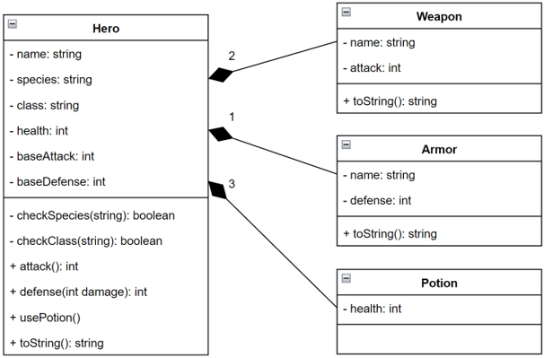
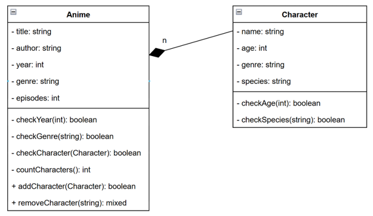
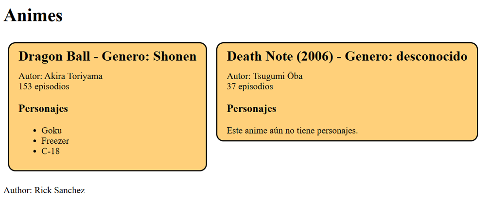
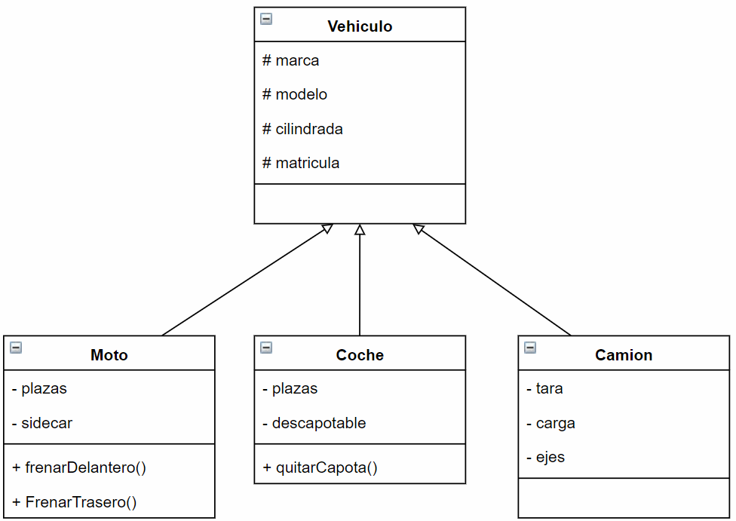
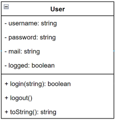
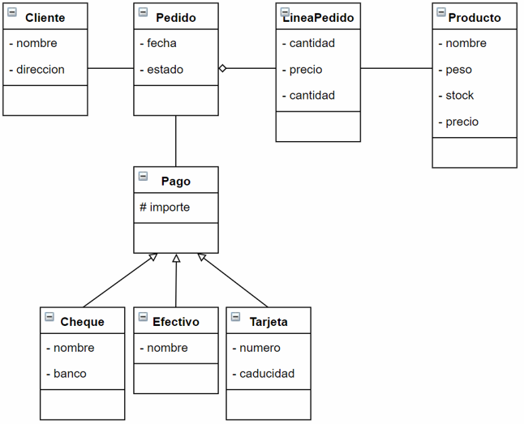
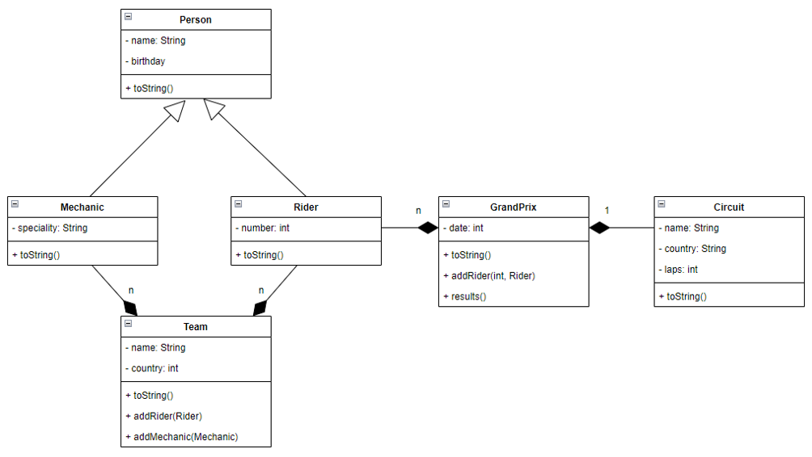

# Actividades de PHP

## Actividad 1: Inventario de héroe

🔴⚫⚫⚫⚫

Implementa las clases necesarias para representar un sistema básico de inventario de un videojuego RPG.

### Diagrama de clases



### Requisitos

Crear las siguientes clases:

- `Hero`
- `Weapon`
- `Armor`
- `Potion`

### Funcionalidades

#### Clase Hero

- Constructor con todas las propiedades.
- Propiedades opcionales:
  - `health = 50`
  - `baseAttack = 10`
  - `baseDefense = 10`
- Getters, setters y `toString()` mágicos.
- Validar especies mediante `checkSpecies()`.
- Validar clases mediante `checkClass()`.
- Si la especie es inválida: `humano`.
- Si la clase es inválida: `ninguna`.
- `attack()` devolverá la suma de `baseAttack` más el ataque de las armas equipadas.
- `defense($damage)` devolverá `baseDefense + defensa de armadura - daño`, siendo 0 el valor mínimo.
- `usePotion()` utilizará la poción que más vida recupere y la eliminará del inventario.

#### Clase Weapon

- Nombre.
- Ataque.
- Constructor completo.
- `toString()` descriptivo.

#### Clase Armor

- Nombre.
- Defensa.
- Constructor completo.
- `toString()` descriptivo.

#### Clase Potion

- Vida recuperada.
- Constructor completo.

### Entrega

Crear un `index.php` donde:

- Se cree un héroe.
- Se le añadan armas, armadura y pociones.
- Se prueben los distintos métodos.
- Se muestre la información antes y después de las modificaciones.

---

## Actividad 2: Anime

🔴🔴⚫⚫⚫

Implementa una aplicación orientada a objetos para gestionar animes y sus personajes.

### Diagrama de clases



### Clases

- `Anime`
- `Character`

### Requisitos principales

#### Character

- Edad por defecto: `-1`.
- Especie por defecto: `humano`.
- Constructor completo.
- Getters y setters mágicos.
- Validación de edad: no puede ser negativa.
- Validación de especie: no puede contener números.
- Valores inválidos:
  - Edad → `-1`
  - Especie → `desconocida`

#### Anime

- Año por defecto: `-1`.
- Colección de personajes mediante array.
- Constructor sin personajes.
- Getters y setters mágicos.
- Géneros permitidos:
  - Kodomo
  - Shonen
  - Shojo
  - Seinen
  - Josei
- Género inválido: `desconocido`.
- Año válido: igual o superior a 1917.

### Métodos

- `countCharacters()`
- `addCharacter()`
- `removeCharacter()`
- `checkCharacter()`

### Programa principal

En `index.php`:

- Crear tres animes.
- Guardarlos en un array.
- Añadir personajes a algunos animes.
- Mostrar toda la información en formato HTML.
- Añadir un pie de página con el nombre del autor.

A continuación, se muestra un ejemplo de visualización:



---

## Actividad 3: Estructura de vehículos

🔴🔴⚫⚫⚫

Implementa la siguiente jerarquía de clases utilizando herencia.

### Diagrama de clases



### Requisitos

- Getters, setters y `toString()` mágicos.
- Utilizar herencia para compartir propiedades y comportamientos.
- Los métodos específicos mostrarán un mensaje descriptivo indicando la acción realizada.

### Programa principal

Crear varios vehículos y demostrar el funcionamiento de todos los métodos.

---

## Actividad 4: Agenda de contactos (Login)

🔴🔴🔴⚫⚫

Desarrolla un sistema sencillo de autenticación utilizando programación orientada a objetos.

### Archivos proporcionados

```text
index.php
userList.inc.php
```

Debes implementar:

```text
User.inc.php
```

### Diagrama de clases



### Clase User

- Constructor completo excepto `logged`.
- `logged` tendrá valor inicial `false`.
- Getters, setters y `toString()` mágicos.

### Métodos

#### login($password)

- Si ya está logueado devuelve `false`.
- Si la contraseña coincide devuelve `true`.
- Si no coincide devuelve `false`.

#### logout()

- Cambia `logged` a `false`.

#### toString()

Formato:

```text
usuario (correo)
```

### Función adicional

```php
userExists(string $username, array $users): mixed
```

### Funcionamiento

- Validar datos recibidos.
- Buscar usuario.
- Comprobar contraseña.
- Mostrar errores cuando sea necesario.
- Mostrar mensaje de login correcto cuando proceda.

---

## Actividad 5: Gestión de pedidos

🔴🔴🔴🔴⚫

Implementa una aplicación orientada a objetos para modelar una tienda online.

### Diagrama de clases



### Clases

- Cliente
- Pedido
- LíneaPedido
- Producto
- Pago
- Cheque
- Efectivo
- Tarjeta

### Requisitos

- Utilizar composición entre pedidos y líneas de pedido.
- Utilizar herencia para los métodos de pago.
- Implementar constructores, getters, setters y `toString()`.

### Programa principal

- Crear varios productos.
- Crear un cliente.
- Crear pedidos con múltiples líneas.
- Asociar distintos tipos de pago.
- Mostrar toda la información generada.

### Ampliación

Calcular automáticamente el importe total del pedido.

---

## Actividad 6: MotoGP

🔴🔴🔴🔴🔴

Desarrolla una aplicación completa para gestionar equipos y grandes premios de MotoGP.

### Diagrama de clases



### Clases

- Person
- Mechanic
- Rider
- Team
- GrandPrix
- Circuit

### Requisitos

#### Team

- Añadir pilotos.
- Añadir mecánicos.
- Mostrar toda la información del equipo.

#### GrandPrix

- Asociar un circuito.
- Asociar una fecha.
- Registrar pilotos y posiciones.

```php
addRider(int $position, Rider $rider)
```

Si la posición ya está ocupada no se añadirá el piloto.

### Programa principal

1. Importar `utils.inc.php`.
2. Crear equipos.
3. Añadir 2 pilotos por equipo.
4. Añadir 2 mecánicos por equipo.
5. Crear 3 grandes premios.
6. Registrar posiciones.
7. Mostrar toda la información generada.

### Ampliación

Añadir a `Circuit`:

- localidad
- kilómetros
- curvasIzq
- curvasDer

Actualizando constructor, getters y setters.

---

## Actividad 7: MotoGP Plus

🔴🔴🔴🔴🔴

Partiendo de la actividad anterior, incorpora nuevas funcionalidades avanzadas.

### Requisitos

- Clasificación general de pilotos.
- Sistema de puntuación oficial.
- Clasificación por carreras.
- Mejor piloto de la temporada.

### Restricciones

- Utilizar programación orientada a objetos.
- Evitar duplicidad de código.
- Aplicar encapsulación y reutilización.
